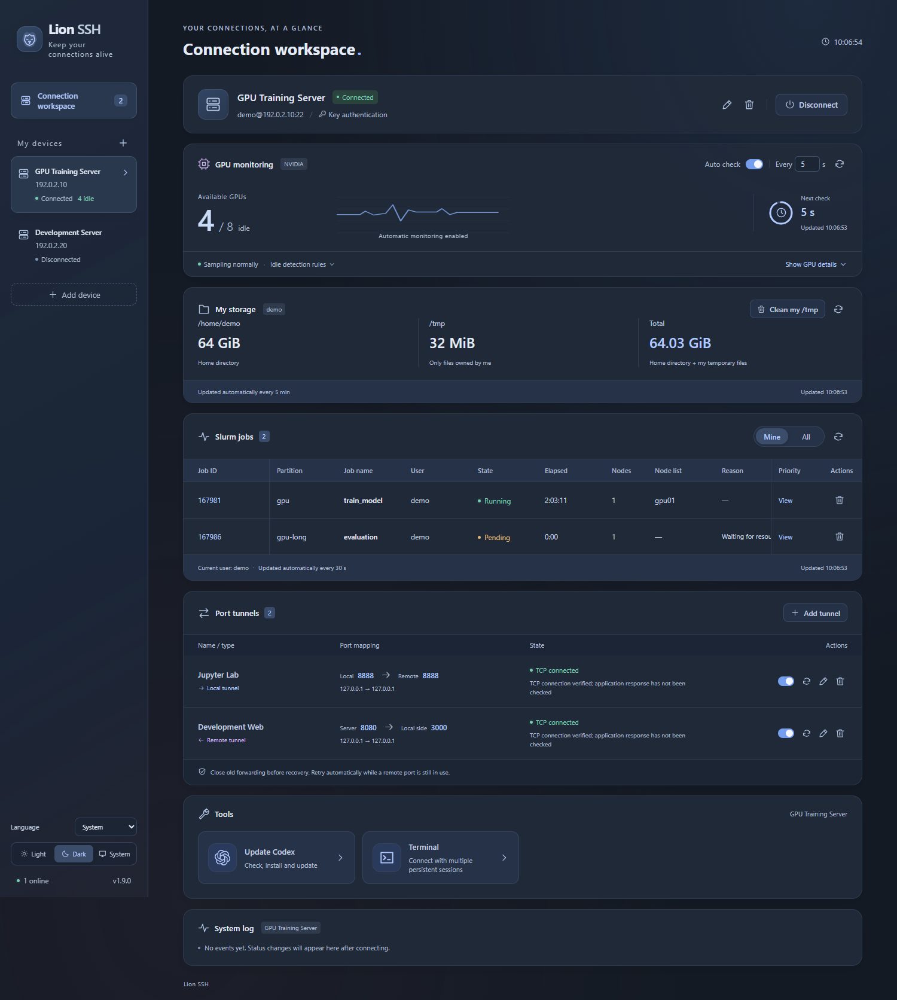

<p align="center"><strong>English</strong> · <a href="README.zh-CN.md">简体中文</a></p>

<h1 align="center">Lion SSH | </h1>

<p align="center">SSH connections, server monitoring, and everyday tasks in one simple desktop workspace.</p>



<p align="center">Workspace preview · demo data</p>

## Features

| Feature | What it does |
| --- | --- |
| Multiple SSH connections | Connect to servers independently using passwords, keyboard-interactive authentication, or private keys with optional passphrases. Confirm host fingerprints on first connection. |
| Port tunnels | Manage forward and reverse tunnels with multiple rules, failure detection, and automatic recovery. |
| NVIDIA GPU monitoring | See GPU usage and idle counts, with scheduled checks, pause, and manual refresh. |
| Slurm job management | View your jobs or all jobs, inspect status and queue reasons, query Priority, and cancel your own jobs after confirmation. |
| Personal storage | Check personal directory and owned `/tmp` usage; preview and confirm cleanup of your own temporary files. |
| Chinese and English | Chinese system locales default to Chinese; all other locales default to English. Manually choose 中文, English, or System, with your preference saved. |
| Themes and system tray | Choose light, dark, or system appearance. Closing the window keeps connections and monitoring running in the tray. |
| Logs and credentials | Review connection and tunnel logs. Remembered passwords and key passphrases are protected by system secure storage. |

## Language

The default is **System**: Chinese system locales use Simplified Chinese, and all other system locales use English. In the bottom-left sidebar, use **Language** to choose **中文**, **English**, or **System** at any time. Changes apply immediately, and your choice is saved for the next launch.

Interface labels, dialogs, notifications, and tray menus follow this preference. Server names, custom terminal names, and remote terminal output keep their original content.

## Tools

### Codex update

Install or update Codex CLI on the selected server with one click. See the installed and latest stable versions; the tool detects the official installer or npm and preserves the installation method.

Native packages are downloaded from official sources and verified on your computer, then transferred over SSH to work around restricted server downloads.

It updates running official managed daemons or restarts verified native systemd user services, then reports version verification and restart results. Reopen ordinary interactive Codex sessions to use the new version. Operations preserve the current SSH user and original installation directories, without `sudo`.

### Command line (Terminal)

Open remote terminals inside the app for everyday commands, with colored output, a visible cursor, and interactive programs.

- Your first visit opens one terminal. Use `+` to add a tab and `×` to close it.
- Double-click a tab to edit its note. Each server keeps its own tabs.
- Sessions stay open when you switch pages or servers or hide the app to the tray, and close when you quit. After an SSH disconnect, reconnect and open a new terminal.
- Right-click selected text to copy; right-click without a selection to paste. `Ctrl+Shift+C` / `Ctrl+Shift+V` also work.

## Download

**[Download from Releases](https://github.com/ZjDing989/LionSSH/releases)**

| Platform | Package |
| --- | --- |
| Windows x64 | Multi-file portable ZIP / EXE installer |
| macOS Apple Silicon | DMG |
| macOS Intel | DMG |
| Linux x86_64 | AppImage |

Windows requires [WebView2 Runtime](https://developer.microsoft.com/microsoft-edge/webview2/); the installer downloads it if missing. The default installation directory is `%LOCALAPPDATA%\Programs\Lion SSH`, and you can choose another location.

## Data

Both Windows editions use `data/` beside the executable and retain the existing JSON formats. macOS and Linux use system user data directories; `LION_DATA_DIR` can override the location. Saved credentials are bound to the current system account and secure store.

## Development and packaging

Built with **Tauri 2 + Rust + Vue 3 + TypeScript**. Release packages do not need Node.js. Development requires Node.js **22.12+**, Rust **1.90+**, and the [Tauri prerequisites](https://v2.tauri.app/start/prerequisites/).

```sh
npm ci
npm start
npm run dist:win
```

Windows packages are written to `release/` as a portable ZIP and an EXE installer. Release packaging requires [Tauri update signing](https://v2.tauri.app/plugin/updater/).

## License

[Apache License 2.0](LICENSE). Third-party dependencies retain their respective licenses and copyright notices.
