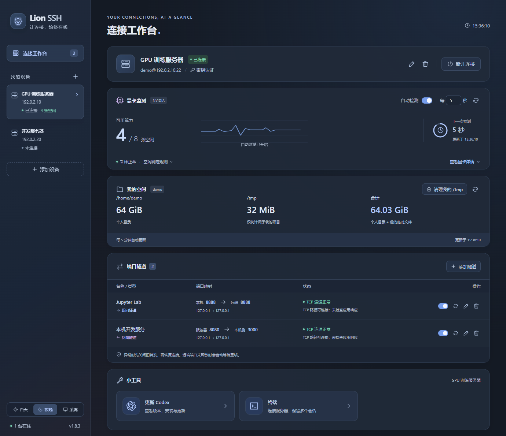

<p align="center"><strong>简体中文</strong> · <a href="README.en.md">English</a></p>

<h1 align="center">Lion SSH | </h1>

<p align="center">把 SSH 连接、服务器监测和日常操作，放在一个简洁的桌面工作台里。</p>



<p align="center">工作台预览 · 演示数据</p>

## 功能

| 功能 | 说明 |
| --- | --- |
| 多设备 SSH | 独立连接多台服务器，支持密码、交互式密码、私钥及私钥口令，首次连接确认主机指纹。 |
| 端口隧道 | 正向 / 反向转发，多条规则独立管理，异常检测与自动恢复。 |
| NVIDIA 显卡监测 | 查看显卡使用情况与空闲数量，支持定时检测、暂停和手动刷新。 |
| Slurm 作业管理 | 查看个人 / 全部作业、中文状态与排队原因，查询 Priority，确认后取消自己的作业。 |
| 个人空间 | 统计个人目录及本人 `/tmp` 文件占用，预览并确认后清理自己的临时文件。 |
| 外观与托盘 | 白天、夜晚、跟随系统三种主题；关闭窗口后常驻托盘，保留连接和监测。 |
| 日志与凭据 | 查看连接及隧道日志，通过系统安全存储保护记住的密码和私钥口令。 |

## 小工具

### Codex 更新

在当前服务器上一键安装或更新 Codex CLI，查看已安装版本和最新稳定版；自动识别官方脚本 / npm 安装，沿用原安装方式更新。

原生安装包由本机从官方源下载并校验，再通过 SSH 传到服务器，减少服务器下载受限的影响。

更新后会更新运行中的官方托管 daemon，或重启已确认的原生 systemd 用户服务，并显示版本校验和重启结果。普通终端中的 Codex 交互会话需重新打开。操作沿用当前 SSH 用户及原安装目录，不使用 `sudo`。

### 命令行（终端）

在软件内打开远程终端，完成日常命令行操作，支持彩色输出、可见光标和交互程序。

- 首次进入默认打开一个终端，点击 `+` 新建，点击 `×` 关闭。
- 双击标签修改备注；不同服务器分别保留自己的标签。
- 切换页面、设备或隐藏到托盘后，会话继续保留，退出软件时关闭；SSH 断线后可重连并新开终端。
- 选中文字后右键复制，没有选区时右键粘贴；也支持 `Ctrl+Shift+C` / `Ctrl+Shift+V`。

## 下载

**[前往 Releases 下载](https://github.com/ZjDing989/LionSSH/releases)**

| 平台 | 发行格式 |
| --- | --- |
| Windows x64 | 多文件便携 ZIP / 安装包 EXE |
| macOS Apple Silicon | DMG |
| macOS Intel | DMG |
| Linux x86_64 | AppImage |

Windows 需要 [WebView2 Runtime](https://developer.microsoft.com/microsoft-edge/webview2/)，安装包会在缺少时下载；默认安装到 `%LOCALAPPDATA%\Programs\Lion SSH`，可手动更改。

## 数据

Windows 安装版与便携版都使用主程序旁的 `data/`，保留原有 JSON 数据格式；macOS / Linux 使用系统用户数据目录，也可通过 `LION_DATA_DIR` 指定。已保存凭据绑定当前系统账户和安全存储。

## 开发与打包

基于 **Tauri 2 + Rust + Vue 3 + TypeScript**，发行包无需 Node.js。开发需要 Node.js **22.12+**、Rust **1.90+**，以及 [Tauri 前置依赖](https://v2.tauri.app/zh-cn/start/prerequisites/)。

```sh
npm ci
npm start
npm run dist:win
```

Windows 打包产物位于 `release/`，包含便携 ZIP 和安装包 EXE；正式打包需配置 [Tauri 更新签名](https://v2.tauri.app/plugin/updater/)。

## 开源许可

[Apache License 2.0](LICENSE)。第三方依赖保留各自的许可证与版权声明。
